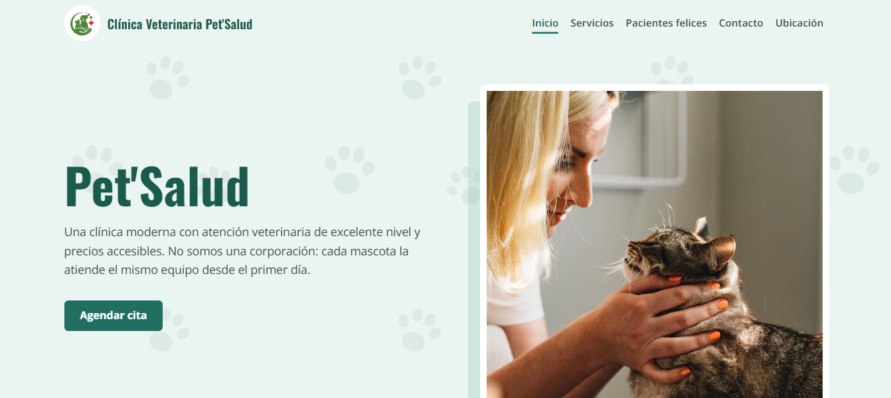

# 🐾 Pet'Salud

Sistema web para una clínica veterinaria: landing page pública
y paneles de administración por rol (recepción y veterinaria) para gestionar clientes, mascotas e informes mensuales.

🔗 **Demo:** https://petsalud.imanol.uk



## 🛠️ Tecnologías

**Frontend:** Thymeleaf

**Backend:** Spring Boot, Spring Security, Spring Data JPA

**Base de datos:** Mysql

**Despliegue:** Docker, Dokploy

## 🚀 Instalación local

### Requisitos
- Java 21 y Maven
- Mysql

### Backend
```bash
git clone https://github.com/ImanolLeon/PetPeru-gestionVeterinaria.git
cd PetPeru-gestionVeterinaria
./mvnw spring-boot:run
```

## 🔐 Variables de entorno
````env
DB_URL=jdbc:mysql://localhost:3306/gestion_veterinaria
DB_USER=USER
DB_PASSWORD=PASSWORD

SERVER_PORT=8080
UPLOAD_DIR=uploads/
````

## 📁 Estructura

```text
Gestion-Veterinaria/
├── src/main/java/.../
│   ├── config/        # Configuración general
│   ├── controller/    # Controladores MVC (devuelven vistas Thymeleaf)
│   ├── entities/      # Entidades JPA (clientes, mascotas, citas, historial)
│   ├── repository/    # Repositorios JPA
│   ├── security/      # Spring Security y roles (recepción / veterinaria)
│   └── services/      # Lógica de negocio
│
├── src/main/resources/
│   ├── static/        # CSS, JS e imágenes
│   └── templates/     # Vistas Thymeleaf
│       ├── layout/        # Plantilla base
│       ├── fragments/     # Menú y paginación reutilizables
│       ├── landing/       # Página pública
│       ├── admin/         # Panel de administración
│       ├── clientes/      # Gestión de clientes
│       ├── mascotas/      # Gestión de mascotas
│       ├── citas/         # Agenda de citas
│       ├── historial/     # Historial clínico
│       └── veterinarios/  # Gestión de veterinarios
│
├── Dockerfile
└── pom.xml
```
